<div align="center">



<br>

[](https://kaker-theng-api.onrender.com)
[](LICENSE)
[](backend/assets/OFL.txt)
<br>
[](backend/requirements.txt)
[](backend/app/main.py)
[](frontend/package.json)
[](https://harfbuzz.github.io/)
[](https://github.com/fonttools/fonttools)
[](backend/app/scan.py)
[](Dockerfile)

**[Open the site](https://kaker-theng-api.onrender.com)** ·
**[Watch the tour](docs/media/kaker-theng-showcase.mp4)** ·
[How it works](#how-it-works) ·
[Run it locally](#run-it-locally) ·
[Deploy it free](#deploy-free)

</div>

---

Turn your handwriting into a **Bangla + English font**. Draw the letters one
at a time in the browser (finger, stylus or mouse), or print a template,
write in the boxes and photograph the pages, or mix the two. Download a
working font (TTF and WOFF2) with correct Bangla vowel-sign placement, reph,
phala and conjuncts.

The name comes from the idiom **কাকের ঠ্যাং বকের ঠ্যাং** ("crow's legs,
heron's legs"), said of messy handwriting.

No accounts, no database, no app to install. Everything you draw is deleted
from the server after an hour.

## See it

<div align="center">

<a href="docs/media/kaker-theng-showcase.mp4" title="Play the 80-second tour (MP4)">
  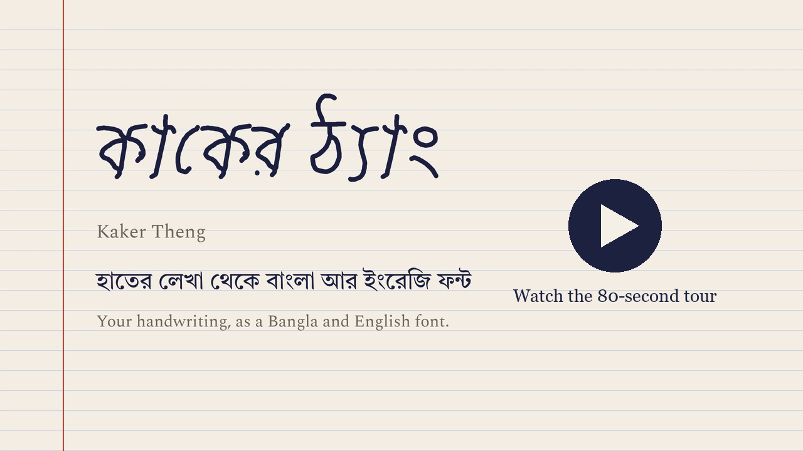
</a>

<sub>An 83-second silent walkthrough on a phone: drawing, vowel signs and phala, typing in the new font, the share card and the font sheet.
Click to play (<code>docs/media/kaker-theng-showcase.mp4</code>, 3.3 MB).</sub>

<br><br>

<table>
  <tr>
    <td align="center" width="25%">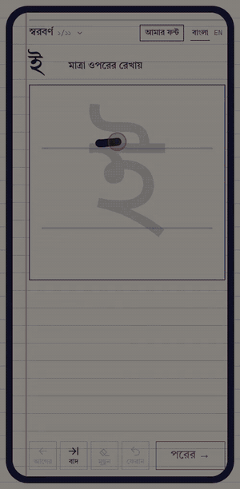</td>
    <td align="center" width="25%">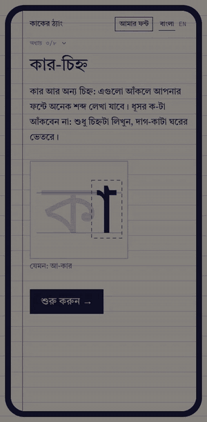</td>
    <td align="center" width="25%">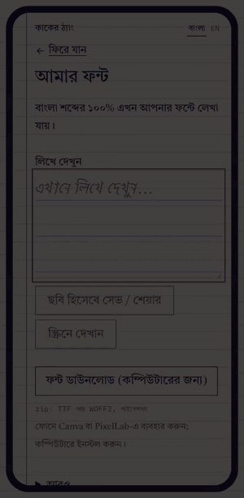</td>
    <td align="center" width="25%">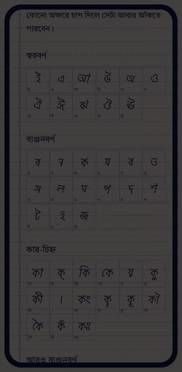</td>
  </tr>
  <tr>
    <td align="center"><b>১ · Draw</b><br><sub>One letter at a time, over a faint guide that keeps every letter the same size.</sub></td>
    <td align="center"><b>২ · Signs and phala</b><br><sub>Only the sign is drawn; a ghost letter shows where it goes.</sub></td>
    <td align="center"><b>৩ · Type</b><br><sub>Anything, in Bangla or English, in your own handwriting.</sub></td>
    <td align="center"><b>৪ · Keep it</b><br><sub>Every letter on one sheet. Tap one to redraw it.</sub></td>
  </tr>
</table>

</div>

## What you take away

<table>
  <tr>
    <td width="46%" valign="top">
      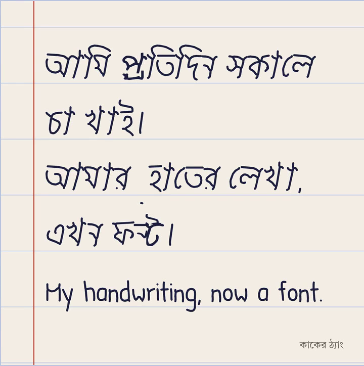
    </td>
    <td valign="top">

Phones can't install fonts, so the main things to take away are things to
**look at and share**:

| What | Format |
|---|---|
| **Try-it text** on khata paper, like the card on the left | phone-sized PNG, or A4 PDF |
| **Font sheet**: every letter you drew, in the font | one PNG, or A4 PDF pages |
| **The font file**, for computers | zip: TTF + WOFF2 + `OFL.txt` + `README.txt` |

The browser draws the pictures on a canvas, which shapes Bangla as the page
does, and each PDF page is that picture. Where the phone has a share sheet
(save to Photos, send on WhatsApp), it is used.

In Canva or PixelLab on a phone, the font file works too.

</td>
  </tr>
</table>

## Two ways in

| **Draw in the browser** (the main way) | **Write on paper** |
|---|---|
| Chapter by chapter: vowels, consonants, vowel signs, phala and reph, optional conjuncts, digits, English. The most used letters come first in each chapter, so the font is useful early. | Print the 3-page A4 template, write in the boxes with a dark pen, photograph each page. ArUco corners let the scanner straighten even a crooked photo. |
| After each chapter you see how much real Bangla your font can already write. | Colour or black-and-white prints and photocopies both work: ink is found by darkness, not hue. |
| The preview font rebuilds after every 5 letters, after 3 s without drawing, and at the end of each chapter. | One page is read at a time; everyone else waits in line and sees their place and an estimated wait. |
|  | 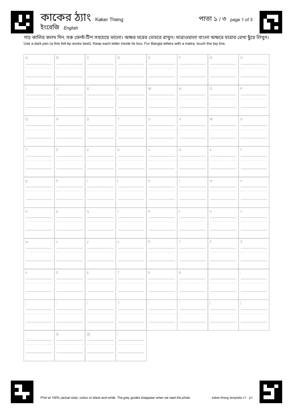 |

The two can be mixed: draw some letters, photograph a page for the rest.

## Bangla is shaped, not stamped

<div align="center">
</div>

Bangla isn't written in the order it is typed. **ি** is typed after its letter
and written before it; **ো** splits around it; a **র** before a hasanta climbs
on top of the next letter as reph; conjuncts fuse two or three letters into
one shape. A font that only maps keys to pictures gets all of this wrong.

Kaker Theng keeps the layout tables (GSUB/GPOS) of **Noto Sans Bengali** and
replaces only the outlines and advance widths with yours. So HarfBuzz, and
every browser and word processor, does the reordering, reph, phala and
conjuncts exactly as it does for Noto, in your handwriting.

- **Conjunct parts come from your own letters.** Half forms, below-base forms
  and headline pieces are cut from what you drew, not drawn again. Each kind of
  derivation is replayed on Noto's own letters first, and only kept if it
  reproduces them.
- **With every cell filled, the font renders 99.4% of the consonant clusters**
  (conjuncts, reph, phala) that occur in 28.0 million words of Bangla Wikipedia.
- **Spacing comes from your ink.** A sign drawn beside the faint ghost keeps
  the gap you left, but never reaches into the next letter. The 200 most common
  clusters are shaped with the new font and widened where they collide.

## How it works

<div align="center">
</div>

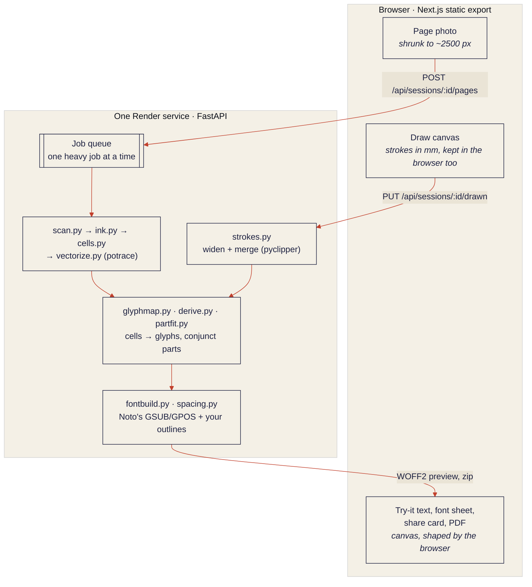

<details>
<summary><b>A drawing session, request by request</b></summary>

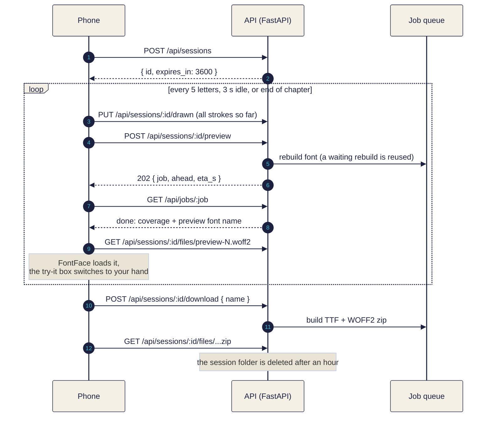

</details>

**In more detail:**

- `backend/` (Python, FastAPI) makes the printable template, reads page
  photos (ArUco corners, darkness-based ink extraction that works for colour
  and black-and-white prints), traces each cell with potrace and builds the
  font on top of Noto Sans Bengali's layout tables, so HarfBuzz in the
  browser handles reordering, reph, phala and conjuncts.
- Drawn letters skip the photo entirely: each stroke arrives as points in
  millimetres inside the same cell box the template prints, is widened to
  the pen width and merged (`app/strokes.py`, pyclipper), and goes through
  the same transform, glyph map, derived parts and font build. Drawing goes
  chapter by chapter (vowels, consonants, vowel signs, phala and reph,
  optional conjuncts, digits, English; `frontend/lib/chapters.ts`), the
  most used letters first within each (`app/draworder.py`). Each letter is
  shown faintly to trace: Noto Sans Bengali for Bangla, Bitstream Vera for
  English. The preview font is rebuilt after every 5 letters, 3 s without
  drawing, and at the end of each chapter. Photo jobs go before these
  rebuilds in the queue.
- Every glyph shares **one transform**: the cell's baseline goes to y = 0 and
  its মাত্রা (headline) to Noto's headline height, so letters drawn in
  different cells line up and match in size (`app/vectorize.py`).
- Which glyph each cell fills is decided **by shaping**, not by hardcoded
  glyph names: each cell is shaped against the base font subset to the
  planned glyph set (`app/glyphmap.py`).
- Spacing comes from the writer's ink. A sign drawn beside the faint ghost
  keeps the gap the writer left, but its body never reaches into the next
  letter. Conjunct parts cut from the writer's letters, and a visible
  হসন্ত, are checked by shaping the 200 most common clusters with the new
  font and widened where they run into a letter (`app/spacing.py`).
  `tests/test_spacing.py` builds fonts from traced, sloppy and synthetic
  drawing and fails if neighbouring letters share ink under the মাত্রা.
- Phones can't install fonts, so the main things to take away are to look
  at: the font sheet (every letter drawn, in the font, on khata paper) as
  one phone-sized picture or as A4 PDF pages, and the try-it text as a
  picture or a PDF. The browser draws them on a canvas, which shapes Bangla
  as the page does (`frontend/lib/khata.ts`); each PDF page is that
  picture (`frontend/lib/pdf.ts`). The phone's share sheet is used where
  there is one. `tests/test_outputs.py` saves a PDF from the real site and
  checks it against the browser's and HarfBuzz's rendering. The font file
  (zip) is still there, for computers.
- `frontend/` (Next.js, static export) is the site: one screen per step. In production
  the backend serves it at `/` and the API under `/api` from the same
  address, so it needs no settings. `NEXT_PUBLIC_API_URL` is only for
  development and for hosting the site elsewhere.

### Built for a free server

Everything runs on one free Render instance: **0.1 CPU and 512 MB**. Measured
locally under the same limits:

| Step | Time |
|---|---|
| Service answers after waking | ~15 s (finishes loading ~20 s later, in the background) |
| Read template page 1 (English) | ~20 s |
| Read page 2 (also builds the Bangla font) | ~45 s |
| Read page 3 | ~35 s |
| Build a download | ~20 s |

One heavy job runs at a time (`app/jobs.py`); up to 5 wait in line and see
their place and an estimated wait, which starts from these times and then
follows how long pages really take on the server.

## Repository map

```text
Kaker-Theng/
├── backend/                     Python 3.13 · FastAPI
│   ├── app/
│   │   ├── main.py              HTTP API, and the website in production
│   │   ├── jobs.py              one heavy job at a time, a queue with ETAs
│   │   ├── sessions.py          per-visitor temp folders, deleted after an hour
│   │   ├── template.py          the printable A4 template (3 pages, ArUco corners)
│   │   ├── scan.py · ink.py     find and straighten the page; ink by darkness
│   │   ├── cells.py             cut cells, empty-cell check, speck cleanup
│   │   ├── vectorize.py         potrace, and the one shared transform
│   │   ├── strokes.py           drawn strokes straight to outlines (pyclipper)
│   │   ├── glyphmap.py          which glyph each cell fills, decided by shaping
│   │   ├── derive.py · partfit.py   conjunct parts from the writer's own letters
│   │   ├── fontbuild.py         outlines + Noto's GSUB/GPOS → TTF / WOFF2
│   │   ├── spacing.py           do neighbouring letters collide?
│   │   └── coverage.py · wordcov.py   how much real Bangla the font writes
│   ├── assets/                  Noto Sans Bengali, layout, corpus counts
│   ├── scripts/                 template, reports, after-deploy check, debugging
│   └── tests/                   end-to-end, spacing, outputs, live site, versions
├── frontend/                    Next.js 16 · static export · plain CSS
│   ├── components/              one screen per step: Start, Draw, Paper, Font…
│   └── lib/                     chapters, strokes, khata pictures, PDF, sharing
├── docs/media/                  the showcase video and the pictures in this README
├── Dockerfile                   one image: builds the site, then the Python API
├── docker-compose.yml           local: site on :3000, API on :8000
└── render.yaml                  Render Blueprint (one free web service)
```

## Run it locally

One command, with Docker:

```sh
docker compose up
```

Then open http://localhost:3000. The API runs on http://localhost:8000.

To run exactly what Render runs (site and API on one address):

```sh
docker build -t kaker-theng .
docker run --rm -p 8000:8000 kaker-theng     # then open http://localhost:8000
```

Without Docker:

```sh
# backend (Python 3.13)
cd backend
python -m venv .venv
.venv/Scripts/python -m pip install -r requirements-dev.txt   # macOS/Linux: .venv/bin/python
.venv/Scripts/python -m uvicorn app.main:app --port 8000

# frontend (Bun 1.3.12; Next.js itself runs on Node 20+)
cd frontend
cp .env.example .env.local
bun install
bun run dev
```

### Tests

```sh
cd backend && .venv/Scripts/python -m pytest tests
```

| Test | What it checks |
|---|---|
| `test_latin_e2e.py`, `test_bangla_e2e.py` | a synthetic page photo all the way through to a working font |
| `test_spacing.py` | fonts from traced, sloppy and synthetic drawing: no shared ink under the মাত্রা |
| `test_conjunct_fit.py` | ra-phala sits under its letter as thick as it was drawn; ন্ন doesn't crowd; । stands apart |
| `test_outputs.py` | a PDF saved from the real site matches the browser's and HarfBuzz's rendering |
| `test_ots.py` | every font a browser is given passes OTS, the sanitizer Chrome and Firefox run first |
| `test_versions.py`, `test_frontend_assets.py` | old template prints are refused cleanly; the site's layout copy is up to date |
| `test_api.py`, `test_site.py` | the HTTP API and the site served from the same origin |

### When a drawn font looks wrong

Open the site with `?debug=1` (or hold down the "আমার ফন্ট" heading on the
My font screen) and tap **Export my strokes**. The file has the strokes
exactly as drawn. Rebuild and check that font with
`cd backend && .venv/Scripts/python -X utf8 -m scripts.from_export <file> <out dir>`:
it prints each glyph's advance against its ink, the letters that collide,
and renders sample words.

## Deploy (free)

One free **Render** web service runs everything: the website at `/` and the
API under `/api`, from one address. **cron-job.org** keeps it awake.

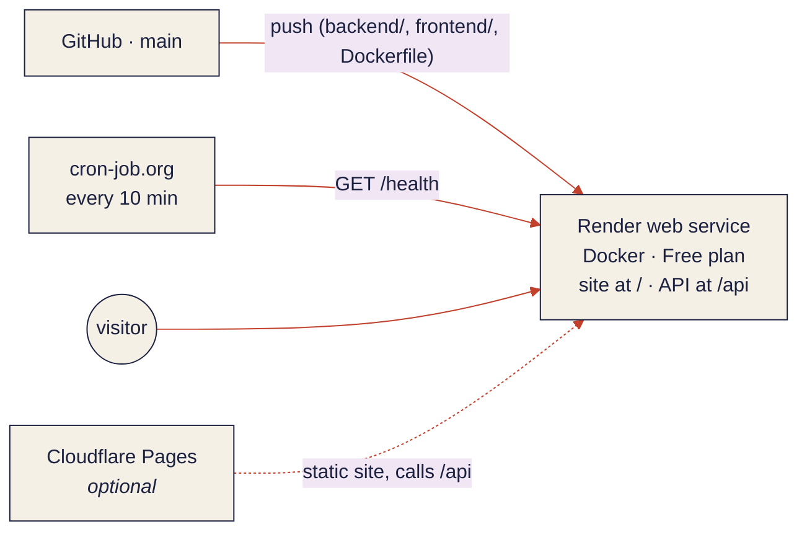

### 0. Put the code on GitHub

Render deploys from a GitHub repository. Push this repository (including
`Dockerfile`, `render.yaml`, `frontend/bun.lock` and `backend/assets/`) to
GitHub, on the `main` branch.

### 1. Render: the site and the API

1. Sign in at <https://dashboard.render.com> (sign up with GitHub).
2. Click **New** (top right) and choose **Blueprint**.
3. Under **Connect a repository**, pick this repository. (The first time,
   click **Configure account** and give Render access to it.)
4. Render reads `render.yaml` and shows one service, **kaker-theng-api**
   (Docker, plan Free). Give the Blueprint a name, e.g. `kaker-theng`.
5. Click **Apply** (or **Deploy Blueprint**). Nothing needs filling in. The
   first build takes about 5 to 10 minutes: it builds the website, then the
   Python image.
6. When the service shows **Live**, open it and copy its address at the top,
   e.g. `https://kaker-theng-api.onrender.com`. That address *is* the site.
   Open it; `<address>/health` should say `{"ok":true}`.

Every push to `main` that changes `Dockerfile`, `backend/` or `frontend/`
redeploys by itself.

<details>
<summary><b>Already deployed the earlier API-only Blueprint?</b></summary>

Push, then in Render open the Blueprint and click **Manual sync** (or wait
for the automatic sync). The service keeps its name and address and is
rebuilt from the root `Dockerfile`. An `ALLOWED_ORIGINS` variable set earlier
can stay: it only matters for the optional Cloudflare setup below.

</details>

Render free services sleep after 15 minutes without requests and take about
a minute to wake. While asleep, the **site itself** waits too, not just the
API, so step 2 matters.

### 2. cron-job.org: keep it awake

1. Sign up at <https://cron-job.org> and confirm your email.
2. In the dashboard open **Cronjobs** and click **Create cronjob**.
3. **Title**: `kaker-theng keep-alive`.
4. **URL**: your address with `/health`, e.g.
   `https://kaker-theng-api.onrender.com/health`.
5. **Execution schedule**: every **10** minutes.
6. Click **Create**. After 10 minutes, the job's **History** should show
   successful runs (status 200).

One always-on service uses about 744 of the 750 free instance hours Render
gives a workspace each month, so don't run a second free service 24/7 in the
same workspace.

### 3. After deploy: check it

From any computer with Python 3.9+ (no packages needed), in this repository:

```sh
python backend/scripts/after_deploy.py https://kaker-theng-api.onrender.com
```

It wakes the service and checks:
- `/health`
- that the site loads, and that its scripts arrive compressed and cached
- both copies of the template PDF
- that other websites get no CORS access (none is needed)
- that the site and the API use the same template version
- one real page upload through to the preview font

All checks should say `ok`. You can pass your own page photo as a second
argument.

Then by hand, on a desktop browser:

1. Open the site and tap **কাগজে লিখুন**. The template button opens a 3-page
   PDF ("template v2" at the foot of each page).
2. Go on to the photo step and add a photo of a filled page 1 (or
   `backend/tests/data/sample-page1.jpg`). You should see "হাতের লেখা পড়ছি…",
   then the straightened page and "৭৬টার মধ্যে … ঘর পড়া গেছে".
3. **আমার ফন্ট**: the try-it box switches to the handwriting, and
   **ডাউনলোড** gives a zip with the font as TTF and WOFF2, `OFL.txt` and
   `README.txt`.

How long things take on the free plan is in
[Built for a free server](#built-for-a-free-server) above.

### Environment variables

| Where | Variable | Example | Needed | What it does |
|---|---|---|---|---|
| Render | `MAX_QUEUE` | `5` | no (5) | Uploads that may wait in line before people are asked to retry. At about 35 s a page, 5 is already a 3-minute wait. |
| Render | `PORT` | `10000` | set by Render | Port the service listens on. |
| Render | `KT_DATA_DIR` | `/tmp/kaker-theng` | no | Where session files go. They are deleted after an hour and need not survive a restart. |
| Render | `ALLOWED_ORIGINS` | `https://kaker-theng.pages.dev` | only for the optional setup | Other website addresses allowed to call the API, comma-separated. |
| Image | `KT_SITE_DIR` | `/srv/site` | set by the `Dockerfile` | Where the built website is; when set, it is served at `/`. |
| Local | `NEXT_PUBLIC_API_URL` | `http://localhost:8000` | for `next dev` | In `frontend/.env.local`. `http://localhost:3000` may call the API whenever it runs without the built site. |

<details>
<summary><b>Optional: the website on Cloudflare Pages</b></summary>

You don't need this. It puts the website on Cloudflare's static hosting
while Render keeps the API. Then the page itself loads at once even while
the free API is asleep, and the site shows "কাক ঘুম থেকে উঠছে… / waking up
the crow…" while the API wakes. The cost is a second service to set up and
the CORS setting below. The Render steps above stay the same.

1. Sign in at <https://dash.cloudflare.com>. In **Workers & Pages** click
   **Create**, choose the **Pages** tab, then **Connect to Git**, pick this
   repository and click **Begin setup**.
2. Fill in **Set up builds and deployments**:

   | Setting | Value |
   |---|---|
   | Project name | e.g. `kaker-theng` (address `https://kaker-theng.pages.dev`) |
   | Production branch | `main` |
   | Framework preset | `Next.js (Static HTML Export)` |
   | Build command | `bun install && bun run build` |
   | Build output directory | `out` |
   | Root directory (under *Advanced*) | `frontend` |

3. Under **Environment variables** add:

   | Variable | Value |
   |---|---|
   | `NEXT_PUBLIC_API_URL` | your Render address, e.g. `https://kaker-theng-api.onrender.com` (no trailing slash) |
   | `BUN_VERSION` | `1.3.12` |
   | `NODE_VERSION` | `22` |

   If `NEXT_PUBLIC_API_URL` is missing, the build stops with a message saying
   so. The address is baked in at build time; if you change it, redeploy
   (**Deployments** → **⋯** → **Retry deployment**).
4. Click **Save and Deploy** (2 to 3 minutes).
5. In Render open **kaker-theng-api** → **Environment**, add
   **ALLOWED_ORIGINS** = the Pages address, e.g.
   `https://kaker-theng.pages.dev` (several separated by commas), and click
   **Save Changes**. Preview builds of other branches get their own addresses
   and are refused unless you add them too.
6. Check with both addresses:
   `python backend/scripts/after_deploy.py https://kaker-theng-api.onrender.com https://kaker-theng.pages.dev`

`frontend/public/_headers` sets caching for Pages. In the one-service image
`backend/app/site.py` does the same job.

</details>

## Changing the template

The template, the scanner and the website share one layout:

1. Change `backend/app/charset.py` or the layout code, then run
   `python -m scripts.make_template` in `backend/`. If a page's cells moved,
   it stops and asks you to bump `TEMPLATE_VERSION` in `app/config.py`:
   old prints of that page are then refused with a link to the new template
   instead of being read with the wrong cells.
2. Run `python -m scripts.export_frontend_assets` to refresh the site's copy
   of the layout, thumbnails and PDF. A test fails if you forget.
3. Push: Render rebuilds the site and the API together, so they always match.
   The after-deploy check confirms it.

## Credits and licences

- This project's code is under the [MIT License](LICENSE).
- **Fonts made with Kaker Theng are under the SIL Open Font License 1.1**, not
  MIT, because they are built from Noto Sans Bengali (below). Every download
  includes `OFL.txt`. You may use, share and sell them, but not sell the font
  files on their own, and modified versions must stay under the OFL.
- The bundled font files keep their own licences: `backend/assets/OFL.txt`
  for Noto Sans Bengali, `backend/tests/fonts/OFL-*.txt` for the test fonts.
- Base font: [Noto Sans Bengali](https://github.com/notofonts/bengali),
  Copyright The Noto Project Authors, SIL Open Font License 1.1. Fonts made
  with Kaker Theng are Modified Versions and stay under the OFL; "Noto" is a
  trademark of Google and is not used in their names.
- Conjunct frequencies (which conjuncts get template cells, and the coverage
  figure shown on the site) are counted from
  [Bangla Wikipedia](https://bn.wikipedia.org/), text licensed
  [CC BY-SA 4.0](https://creativecommons.org/licenses/by-sa/4.0/): 28.0
  million words from 39,724 articles. Only aggregate counts are kept
  (`backend/assets/conjunct_counts.json`).
- The word figure ("you can write 40% of Bangla words") comes from the same
  source: the first 46 MB of the October 2026 dump, 12.7 million words.
  `backend/assets/word_needs.json` keeps no words, only what each word
  needs (its characters and conjunct clusters), for the 40,000 most common
  needs, which stand for 94.6% of the words; the figure is a share of those.
- The English word list, `backend/assets/english_words.json` (the 5,000 most
  common English words and how often each is used, for the "common English
  words your font writes" figure), is from
  [wordfreq](https://github.com/rspeer/wordfreq) 3.1.1 by Robyn Speer. That
  file is under
  [CC BY-SA 4.0](https://creativecommons.org/licenses/by-sa/4.0/), separate
  from the MIT licence of the code. wordfreq includes the SUBTLEX word lists
  by Marc Brysbaert et al., freely available data whose authors must be
  credited. `backend/scripts/english_words.py` makes the file from
  wordfreq's `small_en.msgpack.gz`.
- English tracing guides on the drawing screen: outlines from Bitstream Vera
  Sans (bundled with reportlab), Copyright (c) 2003 Bitstream, Inc., under the
  Bitstream Vera licence.
- Test handwriting fonts: Patrick Hand and Galada, SIL Open Font License 1.1.
- Site fonts: Tiro Bangla, Spectral, IBM Plex Mono (Google Fonts, OFL).
- The handwriting in this README's pictures is a font built by Kaker Theng from
  the test strokes in `backend/tests/synth_strokes.py`, turned into SVG paths
  with HarfBuzz and fontTools, so it looks the same without any font installed.

<div align="center">
<br>
<sub>কাকের ঠ্যাং বকের ঠ্যাং · made by Samonwita Sarker</sub>
</div>
